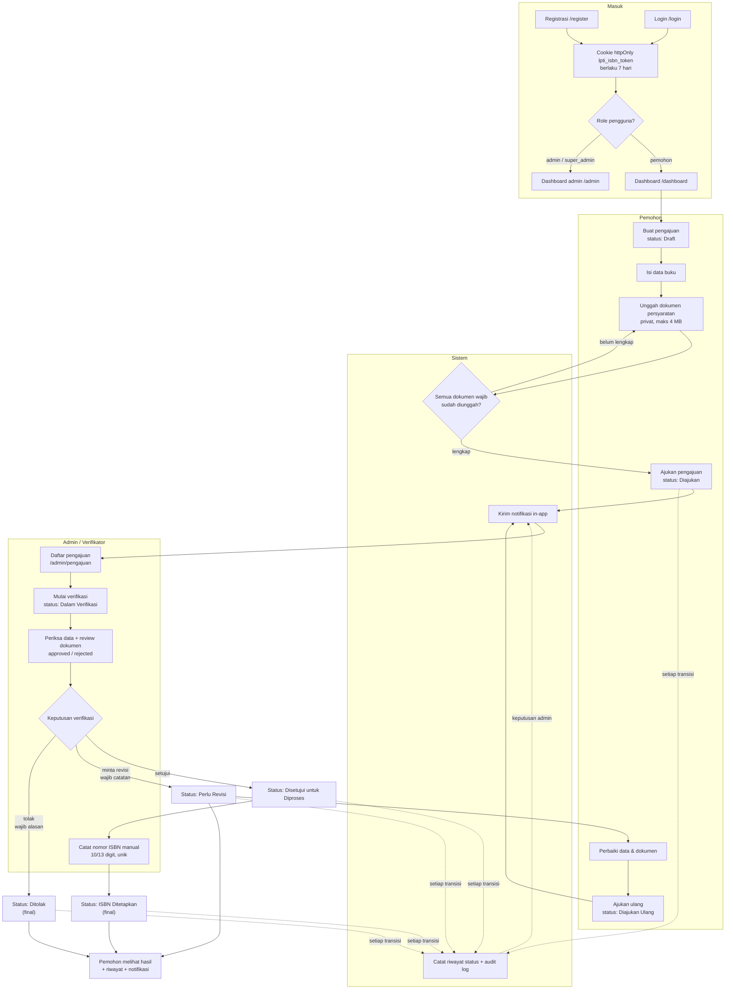
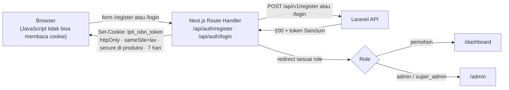
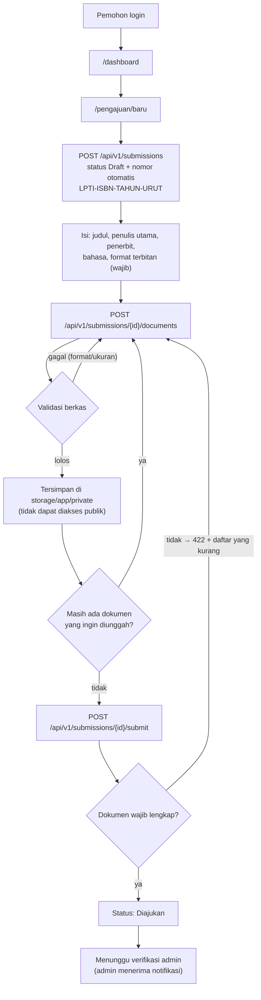
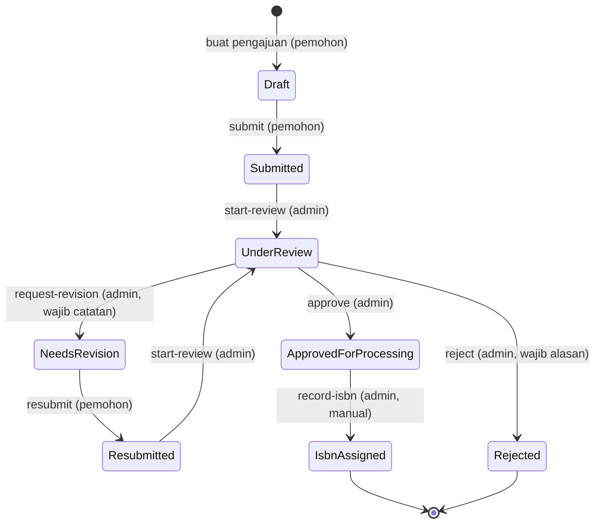
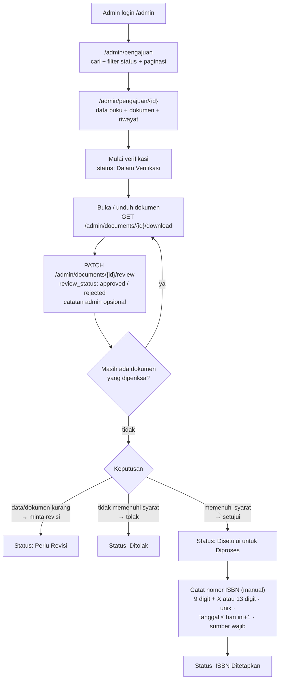
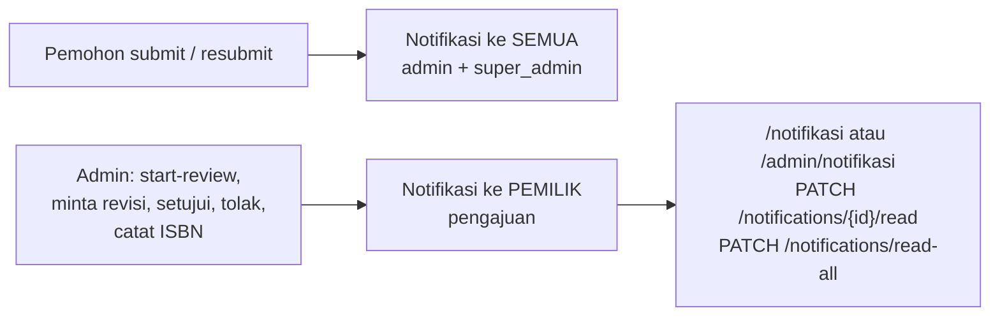
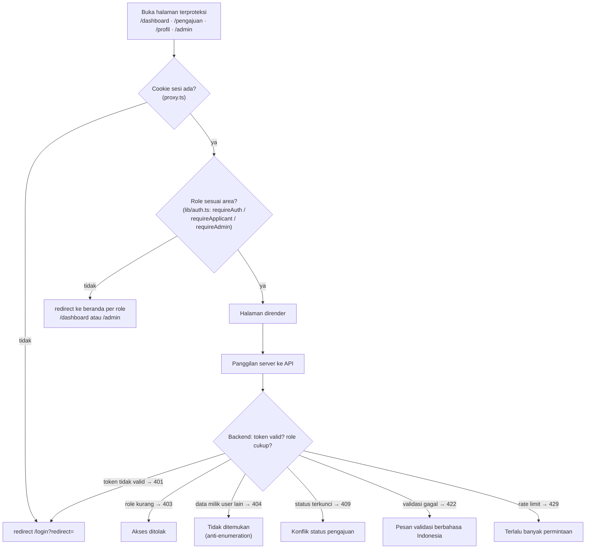
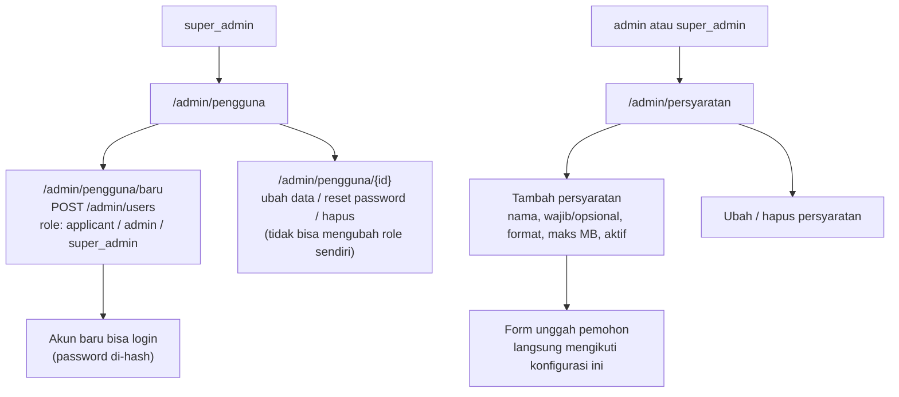

# Alur Aplikasi (Peta Flowchart)

Dokumen ini memetakan **seluruh alur** LPTI-ISBN dalam bentuk diagram
[Mermaid](https://mermaid.js.org/) yang bisa langsung dirender (GitHub/GitLab/VS Code)
atau dipakai sebagai acuan menggambar ulang di draw.io / Figma / Miro.

Sumber kebenaran tetap kode:

| Aspek | Lokasi kode |
|---|---|
| Status & transisi sah | `backend/app/Enums/SubmissionStatus.php` |
| Satu-satunya jalur ubah status | `backend/app/Services/SubmissionStatusService.php` |
| Rute API | `backend/routes/api.php` |
| Guard frontend | `frontend/proxy.ts`, `frontend/lib/auth.ts` |
| Cookie sesi (BFF) | `frontend/app/api/auth/login/route.ts` |

> **Catatan status implementasi:** `/` saat ini masih halaman landing publik.
> Rencana redirect `/` → `/login` (belum login) atau `/dashboard` (sudah login)
> baru berupa backlog — lihat `docs/DEPLOYMENT.md` §9.8. Diagram di bawah
> menggambarkan perilaku **yang sudah jalan**.

---

## 0. Aktor dan halaman

| Aktor | Label | Halaman utama | Halaman admin |
|---|---|---|---|
| `applicant` | Pemohon | `/dashboard`, `/pengajuan`, `/pengajuan/baru`, `/pengajuan/[id]`, `/pengajuan/[id]/ubah`, `/profil`, `/notifikasi` | ❌ (403 / redirect) |
| `admin` | Admin / Verifikator | — | `/admin`, `/admin/pengajuan`, `/admin/pengajuan/[id]`, `/admin/pemohon`, `/admin/laporan`, `/admin/audit`, `/admin/persyaratan`, `/admin/notifikasi` |
| `super_admin` | Admin Utama | — | Semua halaman admin **+ `/admin/pengguna`** (kelola akun) |

Halaman publik: `/` (landing), `/login`, `/register`.

---

## 1. Alur besar end-to-end

---

## 2. Registrasi, login, logout (pola BFF)

Aturan:

- Token **tidak pernah** sampai ke browser; semua panggilan API dari server Next.js.
- Login dibatasi **5 permintaan/menit per email+IP**, registrasi **3 permintaan/menit per IP** → kelebihan → **429** berbahasa Indonesia.
- Logout: `POST /api/v1/logout` (token dicabut) + cookie dihapus.
- Cek sesi: `/api/auth/session`, `/api/auth/me`.

---

## 3. Alur pemohon: membuat sampai mengajukan

Aturan pengeditan:

- Data pengajuan hanya bisa diubah/dihapus saat **Draft** atau **Perlu Revisi**
  (`ubah`), sedangkan **hapus hanya saat Draft**.
- Unggah/hapus dokumen hanya saat **Draft** / **Perlu Revisi** → selain itu **409**.
- `submissions/{id}` milik orang lain → **404** (bukan 403), anti-enumeration.

---

## 4. State machine status pengajuan

| Dari | Aksi | Endpoint | Aktor | Ke | Efek |
|---|---|---|---|---|---|
| — | buat | `POST /api/v1/submissions` | pemohon | `draft` | riwayat awal + audit log |
| `draft` | submit | `POST /submissions/{id}/submit` | pemohon | `submitted` | notifikasi ke semua admin |
| `submitted` | mulai verifikasi | `POST /admin/submissions/{id}/start-review` | admin / super_admin | `under_review` | notifikasi ke pemohon |
| `under_review` | minta revisi | `POST /admin/submissions/{id}/request-revision` | admin / super_admin | `needs_revision` | catatan wajib (5–2000 karakter) |
| `under_review` | setujui | `POST /admin/submissions/{id}/approve` | admin / super_admin | `approved_for_processing` | notifikasi ke pemohon |
| `under_review` | tolak | `POST /admin/submissions/{id}/reject` | admin / super_admin | `rejected` | alasan wajib (5–2000 karakter) |
| `needs_revision` | ajukan ulang | `POST /submissions/{id}/resubmit` | pemohon | `resubmitted` | notifikasi ke semua admin |
| `resubmitted` | mulai verifikasi | `POST /admin/submissions/{id}/start-review` | admin / super_admin | `under_review` | notifikasi ke pemohon |
| `approved_for_processing` | catat ISBN | `POST /admin/submissions/{id}/record-isbn` | admin / super_admin | `isbn_assigned` | ISBN + tanggal + sumber dicatat |
| `isbn_assigned`, `rejected` | — | — | — | final | tidak ada transisi keluar |

Setiap transisi divalidasi di `SubmissionStatus::canTransitionTo()` (status asal +
peran pelaku). Transisi tidak sah → **403**.

---

## 5. Alur verifikasi (admin)

Catatan:

- **Review dokumen per berkas** (`pending` / `approved` / `rejected` + catatan)
  terpisah dari status pengajuan; tidak memicu notifikasi, hanya audit log.
- **Nomor ISBN tidak pernah digenerate sistem** — admin mencatat angka yang
  sudah sah ditetapkan pihak berwenang (kepatuhan: lihat README).
- Laporan: `/admin/laporan` + CSV (`GET /admin/reports/submissions.csv`, tanpa kolom sensitif).
- Audit: `/admin/audit` (`GET /admin/audit-log`).

---

## 6. Notifikasi

| Pemicu | Penerima |
|---|---|
| `submitted`, `resubmitted` | semua pengguna ber-role `admin` dan `super_admin` |
| `under_review`, `needs_revision`, `approved_for_processing`, `rejected`, `isbn_assigned` | pemohon pemilik pengajuan |

Notifikasi disimpan di tabel `notifications` (in-app); email sengaja belum aktif
(`MAIL_MAILER=log`).

---

## 7. Guard akses (frontend + backend)

Mapping middleware backend:

| Middleware | Role yang lolos | Dipakai di |
|---|---|---|
| `auth:sanctum` | semua user login | seluruh `/api/v1` kecuali `register`, `login`, `/up` |
| `admin` | `admin`, `super_admin` | prefix `/api/v1/admin/*` |
| `super_admin` | `super_admin` saja | resource `/api/v1/admin/users` |

---

## 8. Alur admin utama (super_admin) & persyaratan dokumen

Catatan penting:

- Kelola **persyaratan dokumen** boleh `admin` **dan** `super_admin`
  (`hasAdminPrivileges()`); hanya halaman **kelola akun** yang eksklusif `super_admin`.
- Akun yang dibuat lewat UI langsung aktif dan bisa login.
- Pemohon juga bisa mendaftar sendiri di `/register` (role selalu `applicant`).

---

## 9. Aturan validasi & batas

| Aturan | Nilai | Efek bila dilanggar |
|---|---|---|
| Ukuran berkas dokumen | mengikuti `document_requirements.max_file_size` (default **4 MB** / 4096 KB) | 422 |
| Format berkas | mengikuti `allowed_mime_types` (pdf, jpeg, png), dicek dari **isi berkas** | 422 |
| Ubah data pengajuan | hanya status `draft`, `needs_revision` | 409 |
| Hapus pengajuan | hanya status `draft` | 409 |
| Upload dokumen | hanya status `draft`, `needs_revision` | 409 |
| Submit | semua persyaratan **wajib** harus sudah ada | 422 + daftar nama persyaratan |
| Minta revisi | catatan 5–2000 karakter | 422 |
| Tolak | alasan 5–2000 karakter | 422 |
| Catat ISBN | `9 digit + (X/x)` atau **13 digit**, unik, tanggal ≤ hari ini+1, sumber 3–1000 karakter | 422 |
| Review dokumen | `pending` / `approved` / `rejected`, catatan ≤ 1000 karakter | 422 |
| Login / registrasi | 5/menit per email+IP · 3/menit per IP | 429 |
| Akses data pengguna lain | — | 404 (bukan 403) |

---

## 10. Peta halaman ↔ endpoint (untuk node diagram)

| Langkah | Halaman frontend | Endpoint backend |
|---|---|---|
| Registrasi | `/register` | `POST /api/v1/register` |
| Login / logout | `/login` | `POST /api/v1/login` · `POST /api/v1/logout` |
| Profil | `/profil` | `GET/PUT /api/v1/me` |
| Dashboard pemohon | `/dashboard` | `GET /api/v1/submissions/stats` |
| Daftar pengajuan | `/pengajuan` | `GET /api/v1/submissions` |
| Buat / detail / ubah | `/pengajuan/baru`, `/pengajuan/[id]` | `POST /api/v1/submissions`, `GET/PUT/DELETE /submissions/{id}` |
| Unggah / hapus dokumen | di halaman detail | `POST /submissions/{id}/documents`, `DELETE /submissions/{id}/documents/{doc}` |
| Ajukan / ajukan ulang | di halaman detail | `POST /submissions/{id}/submit` · `POST /submissions/{id}/resubmit` |
| Riwayat status | di halaman detail | `GET /submissions/{id}/history` |
| Dashboard admin | `/admin` | `GET /api/v1/admin/dashboard` |
| Daftar pengajuan admin | `/admin/pengajuan` | `GET /api/v1/admin/submissions` |
| Verifikasi | `/admin/pengajuan/[id]` | `POST /admin/submissions/{id}/start-review` · `.../approve` · `.../request-revision` · `.../reject` · `.../record-isbn` |
| Review dokumen | di halaman detail | `PATCH /admin/documents/{id}/review`, `GET /admin/documents/{id}/download` |
| Persyaratan | `/admin/persyaratan` | `GET/POST/PUT/DELETE /api/v1/admin/document-requirements` |
| Akun pengguna (super_admin) | `/admin/pengguna` | `GET/POST/PUT/DELETE /api/v1/admin/users` |
| Laporan & audit | `/admin/laporan`, `/admin/audit` | `GET /admin/reports/submissions(.csv)`, `GET /admin/audit-log` |
| Notifikasi | `/notifikasi`, `/admin/notifikasi` | `GET /api/v1/notifications`, `PATCH /notifications/{id}/read`, `PATCH /notifications/read-all` |
| Persyaratan publik (di form unggah) | — | `GET /api/v1/document-requirements` |

---

## 11. Checklist menggambar ulang (manual)

Kalau mau digambar sendiri (draw.io dsb.), urutan simpul alur utama:

1. **Mulai** → Registrasi / Login (cookie httpOnly) → cek role
2. Pemohon → Dashboard → **Buat pengajuan** (Draft)
3. Isi data buku → Unggah dokumen → **Dokumen wajib lengkap?** (belum → ulangi unggah)
4. **Ajukan** → Diajukan → notifikasi ke admin
5. Admin → Daftar pengajuan → Mulai verifikasi → Dalam Verifikasi
6. Periksa & review dokumen (approved / rejected per berkas)
7. **Keputusan**: setujui → Disetujui untuk Diproses → **Catat ISBN** → ISBN Ditetapkan (selesai)
8. Keputusan: minta revisi → Perlu Revisi → Pemohon perbaiki → **Ajukan ulang** → Diajukan Ulang → kembali ke langkah 5
9. Keputusan: tolak → Ditolak (selesai)
10. Setiap panah status = catat riwayat + audit log + notifikasi
