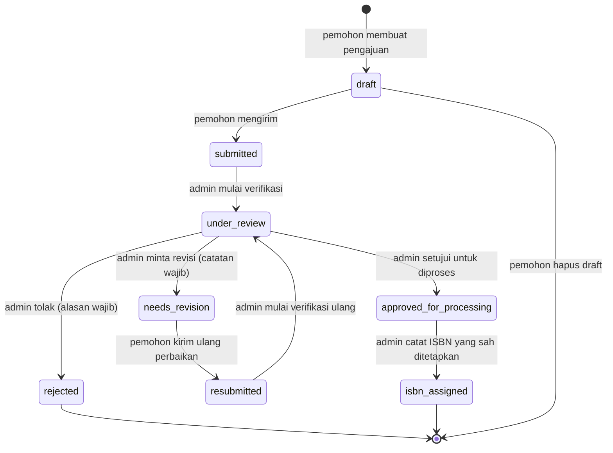

# LPTI-ISBN — Analisis dan Fondasi (Tahap 1)

Dokumen ini merangkum kebutuhan, asumsi, keputusan arsitektur, alur status
pengajuan, risiko teknis, dan rencana implementasi. Dokumen lain:
[`DATABASE.md`](DATABASE.md) untuk ERD/tabel dan [`API.md`](API.md) untuk
kontrak API.

---

## 1. Ringkasan Kebutuhan

**LPTI-ISBN** adalah aplikasi web pengajuan dan pengelolaan ISBN buku dengan
tiga peran utama:

| Peran | Kemampuan inti |
|---|---|
| Pengunjung | Melihat landing page, panduan, persyaratan dokumen, FAQ; daftar & login |
| Pemohon (penulis / perwakilan penerbit) | Kelola profil, buat/edit draft pengajuan buku, unggah dokumen, kirim & kirim ulang, lihat status/riwayat/catatan revisi, unduh ringkasan |
| Admin/Verifikator | Verifikasi seluruh pengajuan, filter & cari, minta revisi / setujui / tolak, catat ISBN yang sah ditetapkan, kelola persyaratan dokumen & panduan, lihat audit log |
| Admin utama (opsional, super_admin) | Kelola akun admin, pengaturan aplikasi, lihat audit log |

**Alur status:** Draft → Diajukan → Dalam Verifikasi → Perlu Revisi →
Diajukan Ulang → Disetujui untuk Diproses → ISBN Ditetapkan, atau Ditolak.

**Batasan yang dipatuhi (dari master prompt):**
- Bukan portal resmi Perpusnas; tidak ada klaim integrasi/otomasi penerbitan ISBN.
- Nomor ISBN **hanya dicatat** (dimasukkan admin) ketika sudah sah ditetapkan pihak berwenang — tidak pernah digenerate otomatis.
- Daftar persyaratan dokumen dikelola admin dan dapat berubah mengikuti aturan resmi.
- Tanpa logo/identitas resmi Perpusnas tanpa izin.
- Dokumen pemohon disimpan **privat** dan hanya diakses lewat endpoint terotorisasi.

---

## 2. Asumsi

1. **Database MySQL** tersedia lokal (Laragon, MySQL 8.4.3) dengan database `lpti_isbn`; kredensial default Laragon (`root`, tanpa password) untuk development.
2. **Satu akun pemohon** mewakili satu identitas (perorangan atau penerbit); pemohon dapat membuat banyak pengajuan.
3. **Nomor pengajuan** dibuat sistem dengan format `LPTI-ISBN-<tahun>-<urutan 5 digit>` (mis. `LPTI-ISBN-2026-00001`) — ini nomor internal sistem, **bukan** ISBN.
4. Field penulis tambahan, editor, dan penerjemah disimpan sebagai teks (nullable) pada `book_submissions` untuk MVP; tabel relasi terpisah hanya dibuat bila kebutuhan muncul.
5. **Email (SMTP)** belum dikonfigurasi → notifikasi cukup in-app (tabel `notifications`); fitur email opsional menyusul bila tersedia.
6. Role `super_admin` disiapkan sejak awal di database/enums, tetapi halaman manajemen admin utama dikerjakan terakhir (bukan penghalang MVP).
7. Bahasa antarmuka sepenuhnya Bahasa Indonesia.
8. Penghapusan hanya berlaku untuk pengajuan berstatus **Draft**.
9. Ukuran file unggahan dibatasi **4 MB per file** untuk MVP (batas aman
   unggah lewat server action Next.js/Vercel; dapat diubah admin per jenis
   dokumen di `document_requirements`, maksimal 4 MB).

---

## 3. Keputusan Arsitektur

### 3.1 Arsitektur Besar

```text
Browser ──► Next.js (App Router, :3000) ──► Laravel 13 API (:8000) ──► MySQL
              │  Server Components                │ Eloquent
              │  Server Actions / Route Handlers  │ Policies, Form Requests
              │  httpOnly cookie (token)          │ Private storage dokumen
              └── BFF layer (lib/api.ts)          └── /api/v1/*
```

- **Next.js** = antarmuka + BFF (Backend-for-Frontend) tipis: merelay request ke Laravel, mengelola sesi, memproteksi route di sisi server.
- **Laravel** = satu-satunya sumber logika bisnis, validasi otoritatif, otorisasi, database, dan file storage.
- **Tidak ada** logika bisnis di Next.js API Routes selain proxy/relay.

### 3.2 Pola Autentikasi (keputusan penting)

**Dipilih: Sanctum *Personal Access Token* + token dikelola sepenuhnya oleh
server Next.js dalam cookie `httpOnly`.** Pola BFF:

1. Browser login lewat Server Action Next.js → Next.js memanggil `POST /api/v1/login` di Laravel.
2. Laravel mengembalikan *personal access token* ( Sanctum ).
3. Next.js menyimpan token di cookie **`httpOnly`, `secure` (di production), `sameSite=lax`** pada origin Next.js. Token **tidak pernah** masuk `localStorage` dan **tidak pernah** dikirim ke JavaScript di browser.
4. Setiap kebutuhan data (Server Component, Server Action, Route Handler) membaca cookie di server Next.js lalu meneruskan `Authorization: Bearer <token>` ke Laravel.
5. Mutasi dari Client Component dipanggil lewat **Server Action / Route Handler** Next.js (bukan fetch langsung dari browser ke Laravel).
6. Download/preview dokumen di-stream lewat Route Handler Next.js → browser tidak pernah tahu URL privat Laravel.

**Mengapa pola ini:**
- Memenuhi larangan menyimpan token sensitif di `localStorage` (master prompt §2 & §9).
- Browser hanya bicara dengan origin Next.js → **CORS dan CSRF antar-origin tidak jadi masalah** di development maupun deployment lintas domain.
- Aman untuk deployment apa pun (domain terpisah maupun satu domain) tanpa konfigurasi stateful-domain yang rapuh.
- Alternatif (stateful Sanctum + cookie langsung lintas origin) dicadangkan bila kelak frontend & backend disatukan di satu root domain; konfigurasinya (`SANCTUM_STATEFUL_DOMAINS`, CORS `supports_credentials`, CSRF cookie) didokumentasikan di `docs/API.md` §5.

**Sesi di sisi Next.js:** cookie `lpti_session` (httpOnly) berisi ID sesi
server-side (disimpan di cookie framework / Laravel session tidak dipakai di
sisi Next). Implementasi detail pada **Tahap 4**.

### 3.3 Upload & Download Dokumen

- Browser → **Route Handler Next.js** (`/api/proxy/...`, multipart) → Laravel `POST /api/v1/submissions/{id}/documents`.
- Laravel memvalidasi ulang **secara otoritatif**: MIME (via guesser + magic bytes), ekstensi whitelist, ukuran maksimum per `document_requirements`.
- File disimpan di **private storage** Laravel (`storage/app/private/documents/`) dengan nama **UUID** (tanpa ekstensi berbahaya; ekstensi disimpan terpisah).
- Akses lihat/unduh hanya lewat endpoint Laravel terotorisasi (policy) yang di-stream kembali oleh proxy Next.js.

### 3.4 Format Respons API (standar)

Semua endpoint mengikuti kontrak di [`docs/API.md`](API.md):
sukses `{ success: true, data, meta? }`; gagal `{ success: false, message, errors? }`
dengan kode HTTP yang tepat (401/403/404/422/429/500).

### 3.5 Status Disimpan sebagai String Enum

Status disimpan sebagai `string` di kolom `status` dan dikendalikan oleh PHP
Enum `App\Enums\SubmissionStatus` + peta transisi tunggal di backend
(service/enum) sehingga **semua** transisi tervalidasi di satu tempat
(fallback aman untuk aturan masa depan yang dapat dikonfigurasi).

### 3.6 Peta Routing Frontend (rencana Tahap 3)

```text
frontend/app/
├── (publik)/          # layout publik + navbar
│   ├── page.tsx                        # Landing page
│   ├── tentang/  panduan/  persyaratan/  faq/
│   ├── (auth)/login/  register/  lupa-password/
├── (pemohon)/         # dilindungi; sidebar pemohon
│   ├── dashboard/
│   ├── profil/  pengaturan/
│   ├── pengajuan/  pengajuan/baru/  pengajuan/[id]/  pengajuan/[id]/edit/
│   └── notifikasi/
└── (admin)/           # dilindungi; khusus admin; sidebar admin
    ├── admin/                              # dashboard admin
    ├── admin/pengajuan/  admin/pengajuan/[id]/
    ├── admin/pemohon/  admin/persyaratan/
    ├── admin/panduan-faq/  admin/laporan/  admin/audit-log/
    └── admin/admin/                        # super_admin
```

---

## 4. Alur Status Pengajuan



### Tabel Transisi (otoritatif — divalidasi backend)

| Dari | Ke | Pelaku | Syarat / data wajib |
|---|---|---|---|
| (baru) | `draft` | pemohon | — |
| `draft` | `submitted` | pemohon | Semua dokumen berlabel **wajib** (`is_required`) terunggah |
| `draft` | *(dihapus)* | pemohon | Hanya draft; hard delete + file ikut dihapus |
| `submitted` | `under_review` | admin | — |
| `under_review` | `needs_revision` | admin | Catatan revisi **wajib**; dapat per-item untuk dokumen |
| `under_review` | `approved_for_processing` | admin | — |
| `under_review` | `rejected` | admin | Alasan penolakan **wajib** |
| `needs_revision` | `resubmitted` | pemohon | — |
| `resubmitted` | `under_review` | admin | — |
| `approved_for_processing` | `isbn_assigned` | admin | Nomor ISBN, tanggal penetapan, catatan sumber/rujukan **wajib** |
| `rejected`, `isbn_assigned` | — | — | Status terminal (tidak bisa berubah) |

### Aturan Kunci

- Pemohon **hanya** bisa mengedit data pengajuan saat `draft` atau `needs_revision`.
- Setelah dikirim, data terkunci sampai admin mengembalikannya (`needs_revision`).
- Setiap transisi menyimpan baris `submission_status_histories`:
  waktu, aktor, status sebelumnya, status baru, catatan.
- `approved_for_processing` ≠ ISBN terbit — hanya verifikasi internal selesai.
- Setiap transisi status juga memicu notifikasi in-app ke pihak terkait (pemohon / admin).

---

## 5. Risiko Teknis & Mitigasi

| # | Risiko | Dampak | Mitigasi |
|---|---|---|---|
| 1 | **Next.js 16.4.2 memiliki breaking changes** (diperingatkan `frontend/AGENTS.md`) | Kode frontend bisa salah konvensi | **Wajib** baca `frontend/node_modules/next/dist/docs/` sebelum menulis kode frontend (Tahap 3+); ikuti deprecation notices di sana |
| 2 | `laravel/sanctum` belum terpasang; Laravel 13 masih scaffold default | Fitur auth tertunda | Pasang & konfigurasi pada Tahap 2 (juga pasang Laravel Boost sesuai `backend/AGENTS.md`) |
| 3 | MySQL tidak ada di PATH shell | Perintah migrate/seed gagal | Pakai path eksplisit Laragon atau tambahkan ke PATH; didokumentasikan di README |
| 4 | Unggahan besar melewati proxy Next.js | Request timeout / memori | Batas 4 MB/file (diperiksa di kedua lapis) + streaming; `experimental.serverActions.bodySizeLimit` 4,2 MB di `next.config.ts` |
| 5 | Kebocoran dokumen privat | Pelanggaran privasi | Private storage + UUID name + policy per-pengguna + audit log akses; tanpa URL publik |
| 6 | Transisi status ilegal | Inkonsistensi data | Peta transisi tunggal di backend; Frontend hanya menampilkan aksi yang valid |
| 7 | Nomor ISBN duplikat / salah input | Data tidak sah | Unique index pada `isbn_number` (NULL diperbolehkan) + validasi format saat dicatat admin |
| 8 | Seeders memakai data pribadi nyata | Pelanggaran privasi | Hanya data dummy faker / contoh fiktif |

---

## 6. Fakta Lingkungan (terverifikasi Tahap 1)

| Komponen | Versi / Nilai |
|---|---|
| PHP | 8.3.30 (ZTS, Laragon) |
| Composer | 2.9.7 |
| Laravel | 13.17 (`laravel/framework ^13.17`), scaffold default — belum ada model/controller/migration aplikasi |
| Node.js | v25.9.0 |
| npm | 11.12.1 |
| Next.js | 16.4.2 (App Router) + React 19.3 + Tailwind 4 + shadcn 4.22 + lucide-react — scaffold default create-next-app |
| MySQL | 8.4.3 (Laragon, `C:\laragon\bin\mysql\mysql-8.4.3-winx64\bin\mysql.exe`, tidak di PATH) |
| Backend `.env` | masih `DB_CONNECTION=sqlite`, `SESSION_DRIVER=database` |

---

## 7. Rencana Implementasi Berikutnya

| Tahap | Lingkup | Output utama |
|---|---|---|
| **2** | Backend Laravel | Pasang Sanctum + Boost; migration 7 tabel; models + relasi + Enums; seeder `document_requirements` & admin; format respons + exception handling; routes `/api/v1` awal (auth); policy |
| **3** | Frontend Next.js | Tailwind/shadcn siap; route groups 3 area; layout publik/dashboard; komponen dasar (badge status, tabel, kartu); proxy BFF `lib/api.ts` |
| **4** | Autentikasi & profil | Register/login/logout/reset; cookie sesi Next.js; proteksi route server-side; halaman profil |
| **5** | Pengajuan & dokumen | Form buku + Zod; draft/edit; upload dokumen privat; daftar & detail pengajuan pemohon |
| **6** | Verifikasi admin | Dashboard admin; review; request-revision/approve/reject; record-isbn; histori |
| **7** | Notifikasi, pencarian, laporan | Notifikasi in-app; filter/cari/paginasi; ekspor CSV; audit log |
| **8** | Pengujian & hardening | Feature test API; uji otorisasi & transisi; build production frontend |
| **9** | Dokumentasi & deployment | README final, `.env.example` lengkap, panduan deploy, checklist keamanan |
